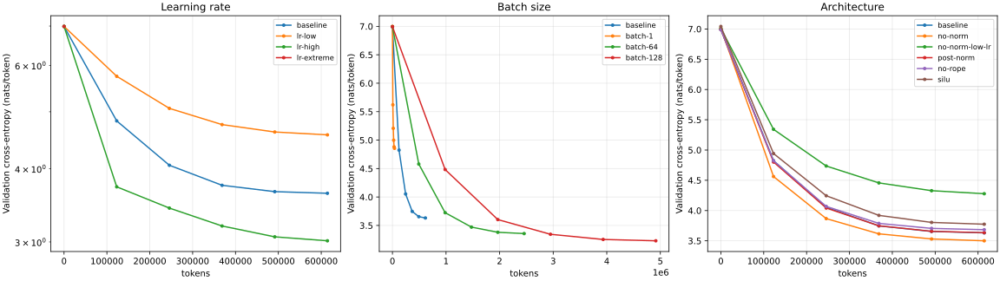
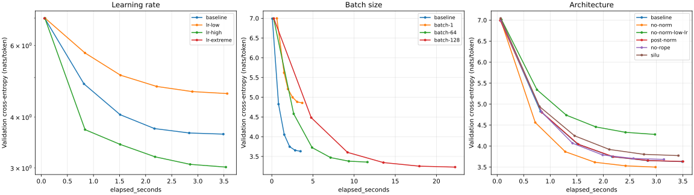

# Assignment 1：实验记录

## 已验证的实现

2026-10-20 在本机运行 `uv run pytest -q`：**55 passed，2 skipped**。其中课程原有测试 46 项通过，新增 9 项覆盖任意文本分块、分词器序列化、批量 RoPE 位置、各架构的因果性与梯度、top-p / EOS 以及 checkpoint 恢复后的下一次参数更新。两个跳过项是 macOS 上的 RLIMIT_AS 内存测试；没有把它们计为通过。

`uv run ruff check cs336_basics tests/adapters.py tests/test_extensions.py` 和 `git diff --check` 通过。CPU 训练 2 步、恢复至第 4 步的命令行流程已执行；MPS 训练、保存和生成流程也已执行。

## TinyStories 端到端短跑

训练源为课程测试 fixture `tests/fixtures/tinystories_sample_5M.txt`；验证源为 `data/TinyStoriesV2-GPT4-valid.txt` 的前 200,000 个字符。训练集用来训练一个包含 `<|endoftext|>` 的 1,000-token BPE，随后编码得到 1,654,416 个训练 tokens 和 62,962 个验证 tokens。BPE 训练耗时约 0.68 秒，训练集编码约 0.66 秒（单次测量）。

模型为 d=128、2 层、4 头、FFN=384、context=128、batch=16，MPS float32，seed=42。AdamW 的 betas=(0.9,0.95)、epsilon=1e-8、weight decay=0.1、梯度裁剪阈值 1.0。初始短跑使用 20 步 warmup，最大学习率 1e-3，最小 1e-4，训练 300 步（614,400 tokens）。验证损失从 6.9902 降至 3.5924，包含验证的循环耗时约 5.63 秒。

该 checkpoint 的实际输出（temperature=0.8、top-p=0.95、最多 256 新 tokens）：

```text
Once upon a time, there was so happy and hop.
<|endoftext|>
```

模型生成 EOS 后停止，因此不足 256 tokens。输出具有简单英语句式，但故事过短且语义不自然；训练 token 数与模型容量限制了建模能力，温度和 top-p 也会影响多样性与提前停止概率。这是功能验证样本，不是充分训练后的流畅度证明。

## 学习率、batch size 与架构对比

采用同一数据和小模型，所有实验运行 300 步，warmup 改为 30 步，最小学习率为 3e-5。每 60 步在固定 seed 的 5 个验证 minibatch 上求平均；验证采样不改变训练随机状态。各实验配置与逐步观测保存于 [`results/quick-comparisons.json`](results/quick-comparisons.json)。

| 实验 | 最终验证损失 | 实际处理 tokens | 循环耗时（秒） |
| --- | ---: | ---: | ---: |
| baseline | 3.6315 | 614,400 | 3.49 |
| lr-low | 4.5674 | 614,400 | 3.56 |
| lr-high | 3.0135 | 614,400 | 3.54 |
| lr-extreme | 第 25 步后出现非有限损失 | 51,200 | 0.41 |
| batch-1 | 4.8559 | 38,400 | 3.70 |
| batch-64 | 3.3572 | 2,457,600 | 11.62 |
| batch-128 | 3.2305 | 4,915,200 | 22.28 |
| no-norm | 3.5004 | 614,400 | 2.99 |
| no-norm-low-lr | 4.2782 | 614,400 | 2.98 |
| post-norm | 3.6338 | 614,400 | 3.50 |
| no-rope | 3.6839 | 614,400 | 3.14 |
| silu | 3.7742 | 614,400 | 3.42 |

按 tokens 比较的曲线：



按耗时比较的曲线：



- 学习率使用 3e-4、1e-3、1e-2 和 100 的粗粒度探索。短跑中 1e-2 收敛最快，极端组在完成 25 次更新后，下一次前向出现非有限损失；这只给出一个非常宽的稳定区间，不能据此断言 1e-2 位于稳定边界。极端组仅有初始验证点，发散位置见原始日志。
- batch 变化实验固定了步数，所以大 batch 同时看到了更多 tokens。batch 128 的更低损失不能单独归因于 batch 大小；按等 tokens、等算力或重新调优学习率的结论还需要补充实验。
- 去掉 RMSNorm 在这次小规模短跑中没有发散，且最终损失略低于 baseline；不能由此推广到更深模型或长期训练。post-norm 与 pre-norm 接近，NoPE 稍差。
- SiLU 小模型使用 FFN=576，与 SwiGLU 的 FFN=384 保持相同 FFN 参数量；这次短跑中其验证损失更高。单个 seed 与有限训练预算不足以得出普遍优劣结论。
- 耗时为单次 MPS 运行测量，包含验证与循环内保存，不包含依赖导入、数据预处理和模型构建；各组可能受首次执行与缓存影响，不是严谨性能基准。

重新绘图（matplotlib 为可选依赖）：

```bash
uv run --with matplotlib python -m cs336_basics.plot_experiments \
  results/quick-comparisons.json --output results/quick-curves-tokens.svg
uv run --with matplotlib python -m cs336_basics.plot_experiments \
  results/quick-comparisons.json --output results/quick-curves-time.svg --x-axis elapsed_seconds
```

## 尚未完成的讲义实验

本次完成了实现、自动化测试和上述短跑，并未完成整份作业的所有实验交付项：

- 完整 TinyStories / OpenWebText 语料上的 10K / 32K BPE 训练、profiling 与跨语料压缩率比较。
- 讲义配置下约 40M tokens 的低资源训练、validation loss ≤2.00 的目标，以及达到该预算的学习率、batch 和架构比较。
- OpenWebText 语言模型的完整训练与生成、45 分钟 B200 leaderboard 实验。

完整数据预处理、训练和对比入口已经提供，见 README。这里的 1K 词表、短语料和小模型结果不能代替上述交付项，也不应与 10K 词表下的 loss 门槛直接比较。数据和 checkpoint 留在被 Git 忽略的 `data/` 与 `runs/` 中；曲线、配置和观测摘要保存在仓库内。
